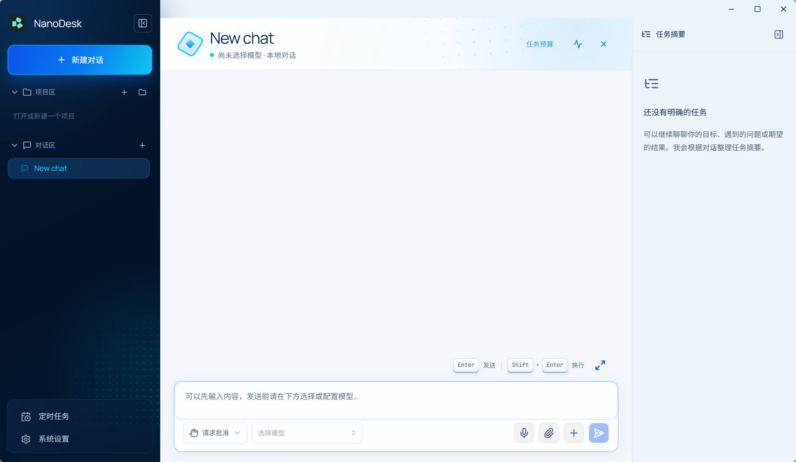
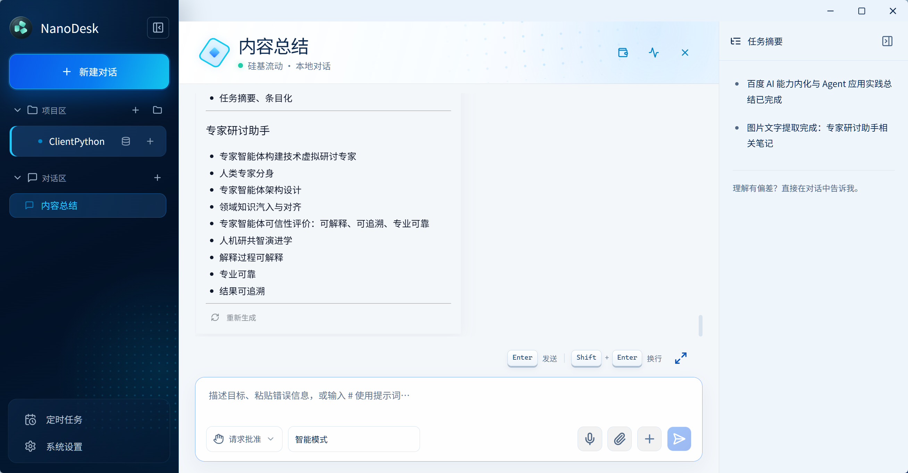

# NanoDesk

NanoDesk 是一个本地优先的桌面 AI 工作台，使用 Tauri v2、Rust、React 和 TypeScript 构建。它把持久化对话、项目文件、轻量 RAG、长期记忆、Skills、MCP 工具、OCR 图片附件、Ops SSH 工作台和运行详情记录集中在一个桌面客户端里，业务数据默认保存在本机 SQLite。





## 核心能力

- 桌面助手粘贴：输入框支持 Ctrl+V 粘贴文本、资源管理器复制的文件和截图；附件可移除，发送时复用现有图片、音频和文档处理流程。
- 桌面助手附件状态：文件名前的灰点表示待发送，黄色动态圆点表示处理中，绿点表示成功，红点表示失败；悬停可查看失败原因。

- 长文档后台预处理：索引完成后预生成分层概要，并一次提取带原文摘录、分块号的待办、风险和决策清单。后续全文问题复用已完成结果，概要补充相关原文；未完成、模型变更或明确要求重新核查时保留原文分析路径。附件显示预处理进度，同文档重试复用成功分组。
- 文档右键对话：在「系统设置 → 通用设置」开启后，可在桌面或文件夹右键 TXT、Markdown、DOCX、文字型 PDF、RTF、CSV、XLSX、PPTX，选择「使用 NanoDesk 对话」打开可移动、缩放的置顶窗口。首次发送创建独立会话；与附件上传共用文档处理流程，短文档直接读取全文，长文档自动分块并分批向量化，全文总结逐块分析后汇总。支持索引进度与失败重试、连续追问、流式回复、停止生成和主窗口复用索引续聊；关闭悬浮窗保留会话。详见[文档右键对话](docs/文档右键对话.md)。

- 桌面助手模式：通用设置开关控制置顶常驻图标，点击在图标上方展开输入条（图标始终保留）创建新聊天，输入 `@` 选择普通或项目会话继续聊天，「+」支持上传图片、音频和文档；发送后后台运行，不弹出主窗口，可手动打开查看结果，右键菜单可显示主窗口或关闭助手。详见[桌面助手模式](docs/桌面助手模式.md)。
- 本地笔记、提示词和长期记忆管理；记忆管理搜索使用 FTS5，聊天召回融合内存词项评分、可选 sqlite-vec 向量和轻量知识图谱。独立用户画像收集持久化会话中的用户输入，在本地词法过滤后按字符、数量或时间异步提取，也可从设置页触发一次人工组批周期；过滤项由用户决定加入或丢弃，完整的结构化内容排除与脱敏仍是规划要求，详见画像设计文档。
- 持久化 AI 对话，支持归档、恢复、删除、项目作用域隔离和会话级模型选择；“供应商管理”只维护 OpenAI/Anthropic 兼容服务连接。“系统设置 → 模型路由”实时获取供应商模型，并通过“供应商 → 模型”二级选择统一配置固定模型列表、均衡/质量/速度/成本四种策略各自的单一模型、兜底模型和全局嵌入模型；未指定模型的策略不可选择。
- OpenAI-compatible Chat/Embeddings、Anthropic Messages API，以及 Ollama/OpenRouter 等兼容服务。
- 流式回复、reasoning/thinking 片段展示、生成中打断并保留已输出内容，以及对最后一条普通回答进行替换式重新生成；同时支持动态 Token 预算、保留原始消息的结构化滚动摘要和 GFM/KaTeX 数学公式渲染。
- 长文本输入：默认最多显示 5 行，超出后在输入区内部滚动；右上角可原地展开或收起输入区，编辑共用同一份草稿，操作栏独立位于文字下方。
- 统一附件上传：聊天输入区用一个回形针按钮选择图片、音频和文档，也支持拖拽或粘贴文件；图片作为附件，音频通过 ASR 转为输入框文字，文档抽取文本并进入轻量 RAG 索引。混合上传按类型处理，单个文件失败会保留其他成功结果。
- 项目索引中心：为项目构建可插拔索引，当前包含代码实体/关系索引和文档片段索引，代码、配置、说明、数据文件问答会优先召回项目级上下文。
- 图片附件和 OCR：图片保存到 `.nanodesk/uploads/images/`，消息中渲染缩略图，点击可预览；`ocr_image` 支持在设置 → 环境依赖的下拉菜单选择本地 PaddleOCR、外部 OCR API（OpenAI 兼容视觉接口）或自建 MinerU API，但当前工具策略拒绝 `.nanodesk` 内路径，因此聊天附件不能直接通过该工具识别。项目内其他允许路径的图片可进入 OCR 执行链路，详见 [OCR 工具说明](docs/图片文字识别工具.md)。
- 语音转文字：聊天输入区支持麦克风录音，以及附件按钮选择或拖拽音频文件，多段识别结果按顺序追加到草稿供编辑后发送；“系统设置 → 模型路由”中的语音识别模型从供应商选择，复用供应商地址和 API Key，并支持可选语言与音频文件测试。
- 归档预览：设置页的 Archive 预览复用普通聊天的消息渲染链路，项目会话使用 `project_path`，普通会话回退到 app data 下的 `temp/`。
- 项目工作区：添加或打开已有项目目录，可从项目条目右键菜单在系统资源管理器中打开目录；支持构建轻量文件索引、浏览文件树、读写/重命名/删除项目文件和执行项目命令。
- 多轮交付物：根据每轮用户目标和文件用途区分中间文件与最终交付物，生成记录与交付标记保存在本地；后续转换或继续编辑不会取消此前的交付身份，脚本本身也可按用户目标成为交付物。详见[对话交付物](docs/deliverables.md)。
- 智能文件链接：聊天 Markdown 中的项目相对路径、裸文件名和已有文件链接会自动解析为项目内真实相对路径；外部 URL 会弹出到系统浏览器，避免应用内跳转。
- Agent 运行时：记录 run、step、tool call，并提供“请求批准 / 帮我批准 / 完全访问”三种应用模式；模式按工具风险决定手动或自动审批，文件读写、命令、OCR 和 MCP 工具始终经过统一安全策略。复杂任务会生成带稳定步骤 ID 和执行状态的结构化计划，并随工具结果持续更新；最新计划与长任务状态一同持久化，可在聊天区和运行详情查看。模型失败后可从最近消息继续，工具失败可在次数上限内重试，应用重启时未完成的工具执行会进入“结果未知、等待恢复”状态，避免自动重复副作用。
- 会话运行提示：正在运行的普通会话和项目会话右侧显示动态进度图标，切换页面后仍保留，停止或结束后自动消失。长文档分析显示已完成分组数、归并层级及复用数量；文档级分层概要可跨问题、跨任务及重启复用，全文总结和关键结论无需每次重新分析原文，全部待办等完整列举仍核查原文。
- 后台任务执行：普通聊天的模型、计划、审批、工具循环和结果续写由 Rust 执行器持有；切换会话或页面不中断，其他会话可继续提交。切回时恢复流式缓冲，结果只保存到原会话；保留停止、澄清、重试和人工恢复。详见[后台任务执行器](docs/后台任务执行器.md)。
- 任务预算与通知：聊天后台任务和定时 / 事件任务支持单任务估算费用、执行时间、步数上限；超限暂停，重试 / 恢复累计用量。模型单价、默认及独立预算可配置，成功完成后发送系统通知。详见[任务预算与通知](docs/任务预算与通知.md)。
- 定时与事件任务：独立后台调度支持单次、固定间隔、每日定时及目录文件变化；支持防抖、失败后延迟重试、错过任务合并补执行或跳过。可执行预设 AI 提示词并读取指定 UTF-8 文本生成 Markdown，或执行授权的本地脚本；提供任务管理、立即执行、暂停、执行记录和人工恢复。应用完全退出时不执行，重启后按策略处理；详见[定时与事件任务](docs/定时与事件任务.md)。
- 结构化澄清：信息不足时，助手可在输入框上方生成带推荐项的选择题；等待选择期间锁定普通输入区，自动模式会代选推荐项并继续执行。
- `nano` 终端客户端：复用桌面端模型配置、会话存储和 Rust LLM 后端，支持项目问答、退出后恢复项目会话，以及不保存历史的普通临时对话。
- MCP 管理：支持 stdio、SSE、streamable HTTP；启用的服务器会在桌面端启动时恢复连接，连接成功后把工具注入模型上下文。
- Skills 管理：同步 Anthropic Skills、维护本地 Skills 目录，并在系统提示中注入启用技能。
- Ops 工作台：管理 SSH 服务器、测试连接、上传文件、打开交互式 SSH 终端。
- 后台用量采集：LLM、MCP、Ops、部分工具和数据库操作写入 `nanodesk-observability.sqlite3`，供用量分析使用；系统设置不再提供链路追踪页面及查询、清空接口。系统操作日志按天写入 `logs/` 并保留 7 天。
- 用量分析：系统设置展示会话数、消息数、按会话当前模型归属统计的助手回答次数、基于已保存消息内容估算的 Prompt/Completion/总 Token 与最近 30 天内有数据日期的趋势；平均与 P95 延迟取观测库最近最多 1000 条有耗时的 span，包含各操作类别及失败调用。暂不包含缓存命中率、费用与成本核算、统一 API 请求量/成功率面板。
- 深色、浅色、跟随系统主题，以及可配置的关闭行为、系统托盘和 Windows 开机自启动。
- 窗口快捷键：NanoDesk 获得焦点时，按 `Esc` 先关闭打开的二级页面或弹窗；回到主界面后再次按 `Esc` 最小化到任务栏。
- 窗口使用无系统标题栏布局，侧栏顶部显示应用图标与 NanoDesk 名称；可拖动品牌区或右侧顶部空白区域移动窗口，右上角提供最小化、最大化 / 还原和关闭按钮，关闭沿用已有关闭行为设置。

- 桌面助手状态提示：点击展开与收起采用 220ms 缩放淡入淡出，失去焦点 5 秒后自动收起，后台聊天任务运行时图标旋转。
- 系统托盘右键菜单按状态显示「隐藏助手」或「开启助手」，与通用设置开关同步。
- 系统托盘右键菜单支持「开启文档对话 / 关闭文档对话」，与通用设置中的文档右键对话开关同步。
- 应用品牌图标统一使用圆形渐变、高光和阴影的立体效果。

## 文档

- [任务规划与上下文压缩](docs/任务摘要与上下文压缩.md)：先规划、用户审核后执行，右侧展示步骤与进度。

- [桌面助手模式](docs/桌面助手模式.md)：通用设置开关、桌面常驻图标、新聊天与 `@` 续聊。

- [系统设计文档](docs/系统设计文档.md)：整体定位、模块边界、关键业务链路和系统约束。
- [定时与事件任务](docs/定时与事件任务.md)：触发规则、后台执行、重试、补执行、文件监听与验收范围。
- [后台任务执行器](docs/后台任务执行器.md)：聊天任务后台执行、会话切换、流式恢复、审批与取消边界。
- [架构与模块设计](docs/架构与模块设计.md)：前端、Tauri command、Rust 后端模块分层。
- [模块化重构记录](docs/模块化重构记录.md)：模块职责、兼容入口、跨层契约和回归验证范围。
- [数据与存储设计](docs/数据与存储设计.md)：SQLite 数据库、核心表、索引、文件边界和附件存储。
- [用户画像异步批处理设计](docs/用户画像异步批处理设计.md)：画像与手工记忆边界、低 Token 候选过滤、批调度、租约、预算和删除屏障。
- [Agent、RAG、MCP 与 Skills](docs/智能体检索增强与扩展工具设计.md)：模型上下文、工具审批、RAG、OCR、MCP 和 Skills。
- [PaddleOCR OCR 工具](docs/图片文字识别工具.md)：本地 OCR 依赖、图片附件、运行时兼容和资源限制。
- [语音识别使用说明](docs/语音识别使用说明.md)：ASR 配置、录音与文件入口、接口协议和排查。
- [模型服务集成协议（服务提供方）](docs/模型服务集成协议.md)：LLM、Embedding、ASR 的接口契约、本机 OCR 边界与联调验收。
- [模型服务接入指南（使用方）](docs/模型服务接入指南.md)：供应商配置、模型选择、OCR 环境准备、调用示例与排查。
- [构建、配置与运维](docs/构建配置与运维.md)：开发、打包、数据位置、配置、安全和排查。
- [技术栈学习路线](docs/技术栈学习路线.md)：按当前项目技术栈设计的分阶段学习路径。
- [文档代码一致性核对记录](docs/文档代码一致性核对记录.md)：本次覆盖范围、源码依据、已知限制及验证结果。

## 技术栈

- 桌面壳：Tauri v2
- 前端：React 18、TypeScript、Vite、Mantine 8、lucide-react、react-markdown、remark-gfm、remark-math、rehype-katex
- 后端：Rust、Tokio、rusqlite、reqwest、serde、thiserror
- 数据库：SQLite + WAL + FTS5 + sqlite-vec
- 模型：OpenAI-compatible Chat/Embeddings、Anthropic Messages API
- 扩展：MCP、Skills、本地 Agent 工具、PaddleOCR
- 运维：SSH/SFTP、Windows NSIS 打包

## 开发环境

Windows 推荐准备：

- Node.js
- Rust 工具链
- Microsoft C++ Build Tools
- WebView2 Runtime

安装依赖：

```bash
npm.cmd install
```

开发运行：

```bash
npm.cmd run tauri dev
```

前端单独调试：

```bash
npm.cmd run dev
```

安装 `nano` 命令行客户端（Windows 开发环境）：

```bash
npm.cmd run install:nano
```

该命令会单独构建并安装 CLI，不会随默认桌面端打包执行。安装完成后打开新终端，即可在任意目录直接运行：

```powershell
nano
```

`nano` 默认以当前目录作为项目并更新代码/文档索引；聊天改为调用与桌面相同的任务执行器，共用工具、审批、澄清、预算、恢复、交付物和整体完成判定。`--access-mode ask` 为默认值，支持 `auto/full`；`--routing` 提供固定、智能和四维路由，任务关键词与桌面共用一份规则，策略模型通过 `--routing-models` 指定。项目会话持久化，`--temp` 的已完成会话会清理且不收集画像，未完成任务保留以便恢复。

使用 `nano --commands` 查看 145 个与桌面同源的业务命令，`nano --call <命令> --params <JSON>` 执行单次命令，`nano --serve` 提供持久 JSON 行会话、后台任务、自动任务、MCP/SSH 连接和实时事件。托盘、窗口、剪贴板和资源管理器菜单等 11 个桌面交互入口不纳入对齐。详见[CLI 功能对齐与协议](docs/CLI功能对齐.md)。首次模型配置、`/model add`、`--sessions/--show/--continue/--resume/--files` 继续支持。

类型检查和前端构建：

```bash
npm.cmd run build
```

Rust 检查：

```bash
cd src-tauri
cargo check
```

品牌名称统一维护在根目录的 `brand.config.json`。修改后运行 `npm.cmd run brand:sync`，将名称同步到 npm、Cargo 和 Tauri 静态清单；`npm.cmd run brand:check` 用于检查清单是否一致。`bundleIdentifier`、`storagePrefix`、`projectDataDirectory` 和注册表字段属于兼容标识，修改时需要同步设计已有数据迁移。

品牌图标统一维护在 `src-tauri/icons/icon.svg`。修改后运行 `npm.cmd run icons:build`，生成多尺寸 PNG、Windows ICO 和托盘 RGBA；侧栏与桌面助手直接复用同一 SVG。安装版的快捷方式、任务栏和托盘图标需重新打包更新后生效。

Windows 打包：

```bash
npm.cmd run package:win
```

`package:win` 会调用 `scripts/build-installer.ps1`，加载 Visual Studio x64 构建环境，修正 Windows 下 Git `link.exe` 抢占 MSVC `link.exe` 的 PATH 问题，并只生成标准 NSIS 安装包：`src-tauri\target\release\bundle\nsis\NanoDesk_0.2.4_x64-setup.exe`。默认跳过独立 CLI、CLI 安装器、离线 NSIS 和 MSI，以减少重复编译与打包时间。

版本变更见 [CHANGELOG](CHANGELOG.md)，安装包从 [GitHub Releases](https://github.com/NanoAgentCode/NanoDesk/releases) 下载。

## 数据位置

运行时数据保存在 Tauri app data 目录下：

```text
nanodesk-config.sqlite3          模型、MCP 与 Ops 配置
nanodesk-conversations.sqlite3   会话、RAG 与用户画像
nanodesk-knowledge.sqlite3       条目、长期记忆、向量与知识图谱
nanodesk-project-index.sqlite3   代码与项目文档索引
nanodesk-runtime.sqlite3         Agent 运行时数据
nanodesk-automation.sqlite3      自动任务、触发游标、文件快照与执行队列
nanodesk-observability.sqlite3   观测数据
settings.json                      Tavily API key 与 ASR 配置
logs/                              按天滚动的系统操作日志（保留 7 天）
skills/                            本地 Skills 目录
temp/                              无项目上下文时的临时工作目录
```

项目内图片附件保存在对应根目录下的 `.nanodesk/uploads/images/`。普通对话没有真实项目路径时，会使用 app data 下的 `temp/` 作为附件和工具工作目录。

## 项目结构

完整运行链路见 [NanoDesk 完整执行流程图](docs/assets/nanodesk-complete-execution-flow.svg)。

```text
src/                           React + TypeScript 前端
src/api.ts / src/api/           兼容聚合出口与按能力分组的类型化 IPC
src/theme.ts                   Mantine 主题与组件默认配置
src/core/plugins.tsx           前端插件契约与微内核注册表
src/plugins/builtin.tsx        内置 UI 插件装配
src/hooks/                     对话、模型、项目、RAG、MCP、Skills、Ops 等状态逻辑
src/hooks/chat/                聊天接口、后台投影与会话消息恢复
src/components/app/            受控项目、重命名与关闭弹窗
src/components/automation/     受控自动任务编辑表单
src/hooks/useAccessMode.ts     三种应用模式状态与本地持久化
src/lib/backgroundAgent.ts     后台任务 IPC 类型与会话展示投影
src/components/                聊天区、侧栏、设置页、运行详情面板、Ops 工作台等 UI
src/lib/                       系统提示、上下文预算与摘要编排、工具解析、格式化和安全封装
src-tauri/src/lib.rs           Tauri command 注册、应用状态和启动流程
src-tauri/src/app_state.rs     共享应用状态与流式取消注册表
src-tauri/src/commands/        按能力分组的 IPC 适配器
src-tauri/src/services/        工具、OCR、环境与观测服务
src-tauri/src/cli.rs           nano 终端交互、模型选择和项目问答上下文
src-tauri/src/bin/nano.rs      nano 命令行二进制入口
src-tauri/src/core/plugin.rs   后端插件契约、清单与 Agent 工具扩展点
src-tauri/src/plugins.rs       内置后端插件装配
src-tauri/src/db.rs            业务 SQLite schema 与共享数据库入口
src-tauri/src/db/              分库迁移及条目、配置、会话、RAG、记忆、画像和项目索引存储
src-tauri/src/db/schema.rs     Schema 初始化与列迁移
src-tauri/src/code_index.rs    项目代码实体、关系和片段索引
src-tauri/src/project_index.rs 项目文档片段索引与通用项目索引查询
src-tauri/src/runtime.rs       Agent run/step/tool call 运行时存储
src-tauri/src/agent_commands.rs Agent 运行时生命周期与审批 command
src-tauri/src/background_agent/ 协议、所有权、生命周期、决策、执行与上下文
src-tauri/src/automation/      自动任务协议、调度、扫描、存储与执行
src-tauri/src/runtime/         run/tool/时间线、恢复及执行请求存储
src-tauri/src/cli/             CLI 模型、共用业务调度、路由、主题与展示
src-tauri/src/llm/             模型协议、供应商、SSE、发现与 Embeddings
src-tauri/src/observability.rs 观测 sink/pipeline 与观测库
src-tauri/src/logging.rs       按天写入并自动清理的系统操作日志
src-tauri/src/llm.rs           Chat、streaming 和 embeddings 请求
src-tauri/src/memory.rs        长期记忆 embedding 编排与混合召回入口
src-tauri/src/profile.rs       用户画像候选过滤、异步 Worker、上下文注入与管理命令
src-tauri/src/db/profile_store.rs 用户画像状态机、预算、租约、Reducer 与删除屏障
src-tauri/src/ops.rs           Ops SSH/SCP、交互终端与 AI 辅助命令
src-tauri/src/mcp.rs           MCP client manager 与传输实现
src-tauri/src/agent_runner.rs  XML tool_call 解析与运行时结果模型
scripts/build-installer.ps1    Windows 打包脚本
scripts/install-cli.ps1        构建 nano.exe、复制到 cargo 所在目录并校验已有 PATH
docs/                          系统设计、运维和学习路线文档
```

## 设计原则

- 本地优先：对话、记忆、项目元数据和运行时记录默认保存在本机。
- 数据隔离：业务数据、Agent 运行时、观测数据分库保存，降低互相影响。
- 显式路径：项目路径、会话 ID、模型 ID、tool call ID 等跨层标识显式传递。
- 可点击资源：模型输出项目文件名或相对路径时，前端基于当前项目文件索引生成可点击链接；裸文件名只在能从项目索引解析时补全。
- 项目优先检索：代码类问题优先使用代码实体/关系索引，文档和普通文件问题优先使用项目文档索引，再回退到普通文件列表或工具读取。
- 分级审批：请求批准模式逐次确认；帮我批准模式按当前规则自动执行低、中风险操作并确认高风险操作；完全访问模式自动执行策略允许项。路径工具检查项目与内部目录边界，MCP 校验当前连接工具范围，命令采用字符串规则；这些规则不构成完整的 Shell 沙箱或外部写操作识别。
- 微内核：应用壳、状态、权限和能力调度保持稳定；主视图、设置页与 Agent 工具通过显式插件注册表扩展。
- 可审计插件：插件随应用静态编译，启动时校验 ID/工具冲突，工具执行仍统一经过策略校验和分级审批。
- 非阻塞观测：观测写入失败只记录错误，不阻断主业务流程。
## 对话交付物

右侧“交付物”选项卡集中展示当前对话的上传附件、成功写入的中间文件和通过回复链接交付的最终文件，支持按本地路径定位。归集范围与分类规则见 [交付物说明](docs/deliverables.md)。
